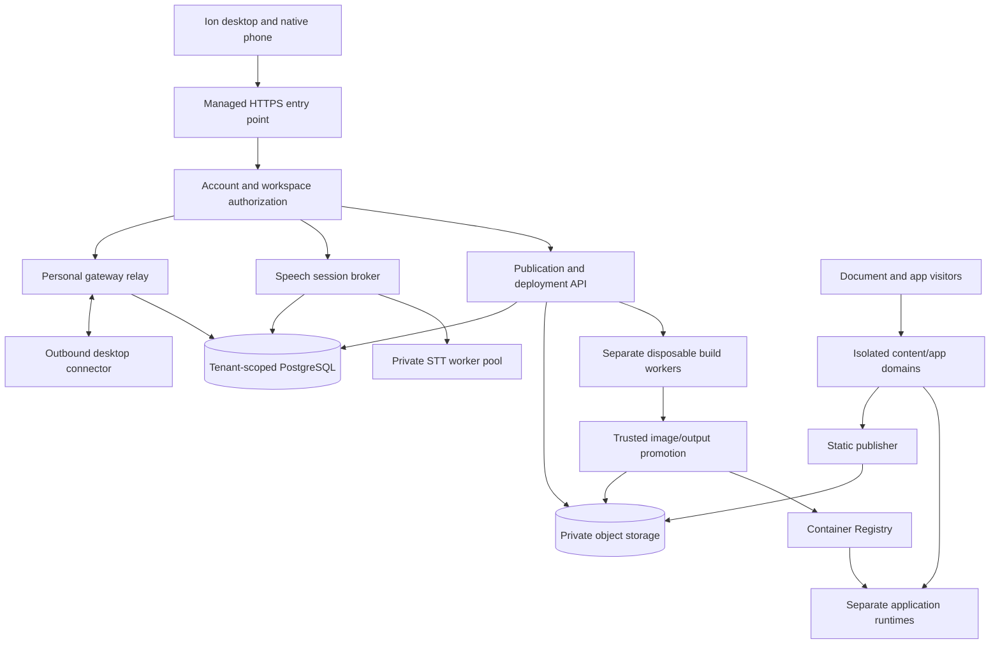

# Managed Ion services on Nebius: speech, personal gateway, apps and HTML publishing

Implementation tracking: [cloud foundation](108-managed-cloud-implementation.md) and [native phone login](109-mobile-cloud-login.md). This research document records the original design; those implementation notes track current completion.

Research and proposal — **18 October 2026**. Scope confirmed by the owner: **10–50 pilot users**, shared operator-hosted STT and personal gateway, deployment of **user-built websites/APIs and HTML artifacts**. This document proposes implementation; it does not report a deployment. No cloud resources were created.

Detailed Nebius evidence and tariffs: [infrastructure research](RESEARCH-nebius-managed-platform-sources.md). Earlier personal deployment instructions remain useful for operators, but their requirement that every user supply a server URL/token is superseded by the managed product proposed here.

## 0. Current scope: hosted authentication without an Ion user database

The owner's latest direction on **18 October 2026** is to **use authentication, without setting up an authentication database**. This supersedes the earlier unauthenticated-pilot request.

Choose **Auth0 Universal Login with native Authorization Code + PKCE**, and validate API access tokens through cached public signing keys. Auth0 operates user identity, login and refresh-session storage; Ion does not build a user/password database, password reset system or authentication session store. This is hosted authentication, not a claim that the identity provider stores no data. See [Universal Login](https://auth0.com/docs/authenticate/login/auth0-universal-login), [PKCE](https://auth0.com/docs/get-started/authentication-and-authorization-flow/authorization-code-flow-with-pkce), [API access-token validation](https://auth0.com/docs/secure/tokens/access-tokens/validate-access-tokens) and [JWKS](https://auth0.com/docs/secure/tokens/json-web-tokens/json-web-key-sets).

For the pilot:

- Use one configured sign-in connection initially, such as Google or GitHub. The operator registers it once; end users only select Sign in. Enable it in production with operator-owned provider configuration where required.
- Register native clients for desktop/mobile and one Ion API audience. Do not embed a client secret in either app. Use accepted native callbacks and PKCE/state checks; prefer claimed HTTPS callbacks on mobile and an approved native desktop callback strategy.
- Verify signature/algorithm, issuer, audience, expiration, not-before and required scopes using a maintained JWT/JWKS library. Accept API access tokens, not ID tokens or a social provider's API token. Cache keys with bounded rotation refresh; do not trust a token-provided arbitrary JWKS URL.
- Use the validated `(issuer, sub)` as the identity key. Derive the initial personal workspace key server-side from that pair; no application `users` table is required just to authenticate or recognize the same person on desktop and phone. Do not use email as an ownership identifier.
- Keep refresh tokens in the OS vault/SecureStore and let Auth0 handle rotation. Propose a configurable short API-token lifetime, initially 15 minutes, subject to the chosen provider configuration. Stateless token verification alone does not provide immediate revocation: existing device-grant checks remain necessary for computer controls, and expiry/provider checks define the remaining access-token revocation window.
- Defer human organization/team membership management; agent teams remain unchanged. User task/artifact/device/deployment records still carry an owner key and enforce ownership independently of authentication.

**No separate database is needed for authentication.** The gateway still needs durable task queues, exact approvals, device revocation, publication/deployment ownership and cost reservations. Retain or introduce appropriate application storage for those records; do not remove it or call the whole shared service stateless. The PostgreSQL deployment below is application infrastructure and can be planned independently from the Auth0 integration.

One-time operator setup is still required: Auth0 tenant, API audience, native client IDs/callbacks, sign-in connection and configuration in the backend/apps. It does not require installing a database or self-hosting an identity server. Auth0 service pricing/entitlements must be checked when creating that tenant; this plan makes no free-tier promise. No Auth0 tenant, authentication integration or cloud deployment has been created yet.

## 1. Recommendation

Build **Ion Cloud**, an operator-managed backend on Nebius. Users sign in to Ion; the app discovers the managed gateway and speech endpoint. They do not create a Nebius account, provision a server, install NeMo, or paste infrastructure keys.

Offer two deployment actions:

- **Publish HTML** on an AI-generated artifact: publish a versioned document/site bundle and return a shareable HTTPS URL.
- **Deploy app** on a project: build a selected source snapshot and host its static website or stateless HTTP backend, with logs, health, version history, rollback and Stop.

Share infrastructure and model weights while keeping each user's devices, connections, tasks, files, approvals and quotas isolated. The platform operator initially pays the Nebius bill; included user allowances and any paid plans are separate product decisions.

Recommended sequence: **identity and tenant boundaries → managed gateway → shared STT → HTML publishing → static app deployment → backend/API deployment**. Build the runtime deployment capability after the account and storage boundaries it depends on.

### What the user still does

Users sign in, approve microphone access, authorize their own GitHub/Gmail/etc. connections, and consent to connecting their computer for remote control. An application may need its own runtime settings or third-party credentials. Hosting these services does not supply Claude/Codex subscriptions, configure every AI provider, or make an offline local computer execute tasks.

Skipping sign-in keeps local functionality available; managed features explain that sign-in is required. Keep existing personal/self-hosted endpoint settings as an advanced option.

## 2. What is feasible on Nebius

| Requirement | Feasibility | Proposed approach |
|---|---|---|
| Shared personal API/gateway | Yes | CPU service, Ion account authorization and durable tenant-scoped state |
| One STT service for desktop and phone | Yes | Shared model workers behind an authenticated speech broker |
| HTML artifact URLs | Yes, with an Ion serving layer | Private object storage plus a static publisher on a separate content domain |
| Static websites built with Ion | Yes | Isolated build, immutable output bundle, same static publisher |
| Node/Bun/Python HTTP APIs | Yes | Separate app runtime per deployment, pinned container image, external state |
| Automatic Vercel-style source deployment | Ion must implement it | Detection, builds, domains, logs, releases and cost policy are platform features |
| Native desktop/mobile app execution in a browser | Outside this scope | APK/EXE distribution can be hosted; it does not make native binaries web apps |

Nebius [Serverless AI endpoints](https://docs.nebius.com/serverless/overview) run custom CPU/GPU containers. Their managed URLs use Nebius Tunnels; [Tunnels](https://docs.nebius.com/tunnels/overview) supports WebSocket upgrades and gRPC. This makes streaming feasible on the documented stack, but Ion must test actual authentication, timeouts and drain behavior. Neither a tunnel nor a provider bearer token supplies Ion's per-user authorization.

**Important limitation:** Nebius [Object Storage does not support static website hosting](https://docs.nebius.com/object-storage/interfaces/s3-api-compatibility). Uploading `index.html` to a bucket is not a complete website deployment. Ion must resolve document paths, serve MIME types, authorize private reads and terminate HTTPS through its publisher.

## 3. Current Ion code: reuse and gaps

These are observations from the checkout, not claims that the hosted platform exists.

| Existing component | Reuse | Work required for managed operation |
|---|---|---|
| `packages/personal-gateway/src/authority.ts` | Device grants, exact-effect fingerprints, revocation and separate proposal/review/execute rules | Bind every authority operation to the authenticated Ion workspace |
| `durable-authority.ts` | Commit before external execution; preserve uncertain outcomes | Current SQLite snapshot has a singleton `id = 1`; add tenant-aware durable storage before sharing |
| `task-relay.ts`, `automation-relay.ts`, `portfolio-relay.ts`, `inbox-relay.ts` | Registered publishers, durable commands, evidence/history | Tenant keys, membership checks, tenant-scoped cursors, quotas and retention |
| `server.ts`, `main.ts` | Existing personal gateway service and private secret loading | One owner token/configuration currently represents one gateway; add real account sessions and per-workspace ownership |
| `composio.ts`, `composio-execution.ts` | Sanitized account summaries and reviewed exact tool execution | Account discovery is currently project-wide; add explicit stable-user filtering and ownership validation |
| `services/speech/` | Pinned runtime/model checks, launch files, readiness and acceptance tools | Shared authentication, admission, quotas, privacy controls, metrics and worker orchestration |
| `crates/waku-credentials/src/speech/` | Desktop HTTP/streaming transport and native capture integration | Managed discovery and renewable account/session authorization |
| `apps/mobile/src/lib/speech-*` | Native PCM capture, previews, cancellation and finalization | Managed session acquisition; remove URL/key entry from the normal hosted path |
| `crates/waku-core/src/control/artifact_library.rs` and existing HTML resource transport | AI-produced documents, revisions, verified source bundles and references | Explicit hosted publication, publication manifest, visibility, URL and unpublish |
| `packages/job-worker/`, `packages/harness-worker/` | Receipts, explicit inputs, lifecycle and isolation principles | Current bounded command worker is not a general source builder or persistent web host; add dedicated build/deploy contracts |

The existing gateway is appropriate for its personal-owner design. Putting all users into that single authority or reusing one public token would break the new product's isolation requirement.

## 4. Target architecture

### Pilot infrastructure

- One stable operator-controlled API domain and CPU control-plane VM; Caddy or an equivalent maintained proxy handles TLS and routing.
- Private PostgreSQL for account/relay/release/metering state. Start with one database host only if the pilot accepts its availability limit; add HA before promising an HA service.
- Private Object Storage buckets for immutable publication bundles, release output and backups; Container Registry for application images.
- A separate speech worker. Benchmark the current CPU runtime first; use an on-demand GPU worker if measured latency/concurrency requires it.
- Disposable build VMs and separate app endpoints/networks. No user build executes on the gateway or STT host.
- SecretStash or restricted runtime secret injection for operator keys. [SecretStash](https://docs.nebius.com/mysterybox/overview) is Nebius's versioned secret service; API identifiers still use `mysterybox`.

Use Nebius Serverless AI endpoints as the first managed app-runtime candidate. A dedicated VM is the fallback deployment substrate when endpoint network/auth/persistence controls do not meet the accepted contract. This is an operator architecture choice, not a new automatic agent-environment mode.

Do not add Kubernetes just to serve 10–50 users. Consider it when runtime count, replicas and deployment operations justify the additional workload policy and ingress configuration.

## 5. Identity and a personal gateway with no server setup

### Sign-in and device flow

1. Desktop/phone signs in through the system browser using Auth0 Universal Login, authorization code and PKCE as selected in section 0. Follow [native OAuth guidance](https://www.rfc-editor.org/rfc/rfc8252) and [PKCE](https://www.rfc-editor.org/rfc/rfc7636).
2. The API derives a personal workspace identity from the validated issuer/subject. No custom user table is needed for authentication. Create application workspace records lazily when storing device/task/publication state. Initial pilot workspaces have one human owner; keep the ownership seam ready for future membership records.
3. `GET /v1/bootstrap` supplies versioned feature availability, managed service origins, limits and device state. Origins are operator-configured; users do not type them.
4. A device receives scoped credentials, renewable through a revocable refresh session stored in the OS vault/SecureStore. Desktop device binding requires explicit consent before remote controls are enabled.
5. A phone signed into the same workspace sees registered computers. The desktop connects outbound; do not expose the desktop's existing full-control daemon token publicly.

The cloud relay forwards allowed, revision-bound commands to the registered desktop. It does not independently grant access to local files or substitute for the desktop daemon. If the desktop is offline, show offline state and bounded queued/rejected commands according to command policy. Running tasks with the computer off requires a separately configured cloud execution owner.

### Tenant storage and execution guarantees

Every device, publisher, task, routine, workflow, connected account, publication, deployment, usage reservation and audit event has a workspace owner. Infer that owner from the validated session; a body/query `tenant_id` cannot choose another owner's data.

Introduce a tenant-aware store interface. PostgreSQL can initially retain a versioned authority snapshot **per workspace** under a row lock while reusing the pure policy core; relay/release/metering records use indexed tenant-scoped tables. Preserve atomic invite consumption, single claims, fingerprints and the persisted `uncertain` state before side effects. Normalize further when measurements justify it. Do not put SQLite on shared object storage or a network filesystem to simulate a multi-replica database.

Use tenant-qualified unique keys and cursor checks, transaction-local database authorization/RLS as defense in depth, non-owner application DB roles, and independent negative authorization tests. Background workers must also carry a verified workspace identity.

### Connected apps

The operator configures Composio once. Each user selects **Connect** in Apps and authorizes their own account. Composio's [authentication model](https://docs.composio.dev/docs/authentication) is explicitly per stable user ID. Its [connected-account API](https://docs.composio.dev/reference/api-reference/connected-accounts) supports ownership filtering and callback identity verification.

Map an immutable Ion owner ID to Composio identity; validate the returning signed-in user at OAuth completion. Filter listings and recheck ownership on execution. Keep pinned tool version, exact connected account, arguments and approval fingerprint. An AI recommendation cannot bypass these checks. A single operator Composio key stays server-side; users' connected accounts are not automatically shared.

## 6. Shared STT implementation

### Runtime choice

The requested `nvidia/nemotron-3.5-asr-streaming-0.6b` is available. NVIDIA's [model card](https://huggingface.co/nvidia/nemotron-3.5-asr-streaming-0.6b) distinguishes ready transcription languages from languages needing adaptation; English and Hindi are in the ready tier. Test real English/Hindi/Hinglish dictation instead of equating tokenizer support with equal accuracy.

| Runtime | Fit | Decision |
|---|---|---|
| Current NeMo-Speech.cpp, CPU/CUDA | Closest to existing clients; useful economical pilot candidate | Keep as an explicitly measured pilot backend |
| NVIDIA Nemotron ASR NIM | Production-oriented GPU container for the same multilingual model | Preferred supported production candidate if its cost and accepted profile fit |

NVIDIA's [C++ serving guide](https://github.com/NVIDIA/NeMo-Speech.cpp/blob/main/docs/server.md) describes that server as local/direct integration and directs production deployments toward NIM. The [NIM model card](https://build.nvidia.com/nvidia/nemotron-asr-streaming/modelcard) includes a multilingual profile and separate container/model terms. Review and pin the applicable license, image digest, model revision and GPU profile during deployment preparation. No license acceptance or purchase is implied by this research.

**Protocol work is required.** Ion currently uses binary PCM plus the NeMo [transcription WebSocket contract](https://github.com/NVIDIA/NeMo-Speech.cpp/blob/main/docs/api.md). NIM's [Realtime API](https://docs.nvidia.com/nim/speech/latest/reference/api-references/asr/realtime-asr.html) uses different session events, paths and finalization semantics. Put an adapter behind Ion's speech API. In particular, never translate a NIM buffer acknowledgment into Ion's successful completion before the final transcript is actually confirmed. Existing WAV imports also need a deliberately tested path because the [Nemotron NIM profile](https://docs.nvidia.com/nim/speech/latest/asr/deploy-asr-models/nemotron-asr-streaming.html) supports streaming mode.

### User and audio flow

1. Tap the mic; signed-in clients request `POST /v1/speech/sessions`.
2. The broker checks account state, remaining allowance and available worker capacity, atomically reserving a bounded session.
3. It issues a short-lived, one-use, speech-only ticket. The ticket carries a session/device/workspace binding; no model server, Nebius or NGC master key enters the app.
4. The client opens the managed speech socket. The broker selects one healthy worker and pins that session to it. Authenticate native sockets through headers; retain a dedicated capability design if browser capture is added later.
5. Stream PCM with bounded buffering and previews. Stop waits for confirmed final output; Cancel discards pending text. Preserve current phone 60-second/desktop 120-second bounds and no automatic audio replay or destination switch.
6. Meter validated audio duration and release the reservation on closure or lease expiry. Failed/canceled sessions follow a published allowance policy.

Start pilot admission at **one active stream per user and a small global cap**, for example four, increasing only after measured acceptance. This is a proposed protection limit, not a statement of backend capacity. Use expiring database leases initially; add a separate coordination cache only when needed.

Audio is transient by default, with no raw audio/transcript in routine logs and no training reuse. Persist only operational counters unless a user explicitly attaches a transcript to a task. Enforce byte, duration, sample-rate and finalization limits on the server; client limits alone do not constrain misuse.

Benchmark CPU and GPU using 1-, 10-, 30- and 120-second clips, silence, noise and accented/code-switched speech; ramp 1/2/4/8 simultaneous streams. Measure first preview, finalization p95, real-time factor, memory, CPU/GPU load and errors. Choose capacity from this result, not total registrations or NVIDIA's different-runtime throughput charts. NIM's [support matrix](https://docs.nvidia.com/nim/speech/latest/reference/support-matrix/asr.html) supplies hardware requirements; verify the exact L40S image/profile rather than assuming compatibility from VRAM alone.

## 7. HTML artifact publishing

### Product flow

On an artifact card: **Publish HTML → review title/visibility → Publish → Copy link**. Default visibility is private to the owner/workspace. Public visibility is explicit. Add View deployment, Publish new version, Roll back and Unpublish to that artifact's menu; keep the existing card library and inline filters.

An artifact remains AI-produced; the user authorizes publication of a selected revision. Publishing does not turn the library into a manual file-upload manager.

### Publication pipeline

1. Resolve the selected revision and its already-verified bundle: HTML plus local CSS, images, SVG and fonts. Reject missing files, traversal, symlinks, oversized bundles and credential/private-file inclusions.
2. Create an immutable publication manifest: workspace/project/artifact/revision IDs, file hashes, safe paths, MIME types, entry path, content mode, visibility and policy version.
3. Upload only that manifest's files to a private owner-scoped object prefix. Use explicit hashes, not the assumption that an S3 ETag is a content checksum.
4. Serve through a dedicated publisher using the selected entry path. Preserve relative paths. Apply SPA fallback only for a declared application, not every artifact.
5. Activate the release pointer only after files and checks succeed. An idempotency key and durable operation record prevent duplicate or ambiguous publishes.

Keep **document publishing** and **executable web-app publishing** distinct. Document mode can publish a sanitized derivative with scripts disabled, while preserving the exact original as an authenticated download. The derivative and original have separate hashes. Interactive HTML/JavaScript uses app mode on an isolated origin, with network permissions and visibility disclosed.

Use separate content/app domains, ideally a different registrable domain from account/API pages, and host-only authentication cookies. Never give arbitrary HTML an Ion session token, desktop bridge or operator credential. CSP and sandboxing help constrain content but do not replace origin separation; see [CSP guidance](https://developer.mozilla.org/en-US/docs/Web/HTTP/Guides/CSP).

Private documents use a short-lived publication-only access exchange; subresources share a bounded scoped session on the content host. Public files can be cached by release hash. Revocable/private responses cannot rely on indefinitely cached public bytes. Unpublish removes routing and invalidates access; it cannot recall content already downloaded by a visitor.

Publishing is explicit upload to the managed service. Show that fact for local artifacts. Preserve the owner's existing **keep until explicitly cleaned** retention preference. Pin active publication objects; unpublish, deleting a source artifact and storage cleanup are separate operations. Never silently remove an active published site's assets during artifact cleanup.

## 8. User application and API deployment

### Pilot app contract

Support static HTML/CSS/JS and built static frontends first. Then add selected stateless HTTP runtimes, for example Node/Bun and Python/FastAPI. Require a build/start command, declared listening port, readiness path and resource size. Detect defaults but let the user review them. Do not promise arbitrary Dockerfiles, databases, cron workers or multi-service stacks in the first app increment.

Persistent app data belongs in explicitly provisioned app-owned storage/database services. Endpoint-local storage is disposable. A database migration can make application rollback unsafe: do not describe switching the image as rolling back external data.

### Deployment flow

Project → **Deploy** → detected application → source revision/files → runtime settings and secrets → estimate/limits → private preview → promote to public or configured production destination.

Use a project **Deployments** view for status, URL, logs, version, cost estimate, Stop, rollback and removal. Keep **Apps** for Composio connections; keep **Workflows** as the existing dynamic project workflows. A workflow can generate test/build/deploy/check stages using the deployment API rather than adding a fixed workflow type for every framework.

### Build and runtime boundaries

- Export an exact reviewed source snapshot; exclude `.env`, credential files, caches and private keys. Record file manifest and lockfiles. Do not upload the whole working directory implicitly.
- Run install/build commands only in a disposable worker isolated from the control plane, other users and operator credentials. Builds execute user code even when the command is just `npm install`.
- Give the worker narrow input access. A trusted promotion step validates outputs and uploads the static bundle or image; never mount a global registry credential or Docker socket into arbitrary builds.
- Run each backend in a separate accepted runtime with explicit CPU/RAM/process/disk/egress limits, no privileged mode, no host mounts, no control-plane service account and no reachability to database/STT/admin networks.
- Prove metadata and internal-network isolation on the actual Nebius runtime. Security groups alone are insufficient for every link-local boundary. If an endpoint cannot enforce the required contract, use separate VMs or keep that class unavailable.
- Ordinary containers or Kubernetes namespaces alone are not a hostile-code security boundary; Kubernetes documents [sandboxing considerations](https://kubernetes.io/docs/concepts/security/multi-tenancy/#sandboxing-containers).
- Pin image digests and runtime secrets by release; health-check before moving traffic. Persist provider resource IDs before further lifecycle actions. Reconcile an uncertain create/update before retrying.
- Keep user app/API authentication separate from Ion management authorization. A private app needs a tested visitor access mechanism; a public API may define its own authentication. Do not publish the Nebius endpoint control token to browsers.

Serverless endpoints are useful for a few pilot backends, but each selected compute preset has a running cost. This is not fractional-container/pay-per-request hosting. The [endpoint lifecycle guide](https://docs.nebius.com/serverless/endpoints/manage) documents explicit start/stop and managed URLs; automatic zero-idle cost and native custom-domain automation are not established by the inspected contract. Provide custom domains through Ion's proxy and verified domain ownership, initially as a later increment.

Keep deployment tasks independent from the agent's selected **Local/Nebius** execution environment. A Local coding agent can call the cloud deployer for its reviewed output. This does not reintroduce automatic agent routing or bring unfinished harness adapters into scope.

## 9. API and storage seams

Proposed modules under `services/ion-cloud/`: account sessions, tenant context, gateway adapter/store, speech broker/runtime adapter, publication serving, deployment orchestration, quotas/metering and operator administration. Reuse the existing gateway policy core and typed client conventions. Choose one backend runtime initially, matching the current Bun/TypeScript gateway; isolate STT runtime/container dependencies.

Suggested public API groups, subject to a versioned contract review:

| Group | Operations |
|---|---|
| Account/devices | Sign-in callback, refresh/logout, bootstrap, bind/revoke device |
| Gateway | Existing task/workflow/decision/history operations with authenticated workspace ownership |
| Speech | Create/cancel session, bounded model/capability readiness, authenticated streaming |
| Publications | Plan/upload/activate, inspect versions, visibility, rollback/unpublish |
| Deployments | Plan, create release, status/log cursor, promote, stop, rollback/remove |
| Usage | Speech seconds, builds, runtime hours, storage/egress estimates, allowances |

Add tenant-qualified application records for devices, connection mappings, speech leases, object manifests, publications, deployment operations/releases, reservations and audit events. Auth0 owns authentication records; human workspace membership management is deferred. Keep provider operation identity, plan/approval fingerprints and idempotency records durable.

Desktop and phone share contracts, but each keeps native credential handling. Normal startup discovers service readiness in the background; render reads cached status and never blocks on network/secret I/O. Missing entitlement or connectivity produces a clear unavailable/offline state.

## 10. Costs and practical limits

Illustrations checked 2026-10-18, USD before tax, 730 hours/month. See the research file for component formulas and exclusions.

| Pilot configuration | Illustrative monthly compute/database baseline |
|---|---|
| CPU gateway 2vCPU/8GiB + CPU STT 8vCPU/32GiB + one 2vCPU/8GiB PostgreSQL host | About **$343**; speech capacity unverified |
| Same gateway/database + one L40S Intel 1GPU/8vCPU/32GiB speech worker | About **$1,281**; speech capacity unverified |

Sources: [Compute prices](https://docs.nebius.com/compute/resources/pricing), [presets](https://docs.nebius.com/compute/virtual-machines/types), [PostgreSQL prices](https://docs.nebius.com/postgresql/resources/pricing). Add disks, backups, object operations/storage/egress, build hours, app runtime hours, domain/identity/Composio fees and any applicable runtime support/license cost. These are alternatives, not quoted all-inclusive service plans; shared CPU sizing and availability require measurement.

Static publications share the publisher's serving capacity. A continuously running backend on its own example 2vCPU/8GiB AMD endpoint adds about **$48/month before disk and other charges**; ten such backends add about $482. App count and idle lifetime therefore matter even in a small pilot.

For 10–50 users, benchmark CPU first and do not reserve an expensive GPU solely because the model can use one. A scheduled GPU reduces running hours but makes speech unavailable or cold-start delayed outside that schedule. Always-on instant dictation needs warm available capacity and a budget for it.

Enforce per-user audio minutes, active sessions, publication bytes, build duration/concurrency, app count and runtime reservations. Provide operator feature switches and idle preview expiry, while preserving explicit artifact retention. Provider budgets are [delayed alerts, not hard spending caps](https://docs.nebius.com/signup-billing/budgets). Admission and stop policies reduce exposure but still need safety margins for provider billing lag and delayed termination.

## 11. Sequenced implementation and acceptance

| Increment | Deliverable | Required exit evidence |
|---|---|---|
| 1. Cloud foundation | Infrastructure definitions, stable TLS origins, operator identities/secrets, private DB/buckets, logs and rollback plan | Reproducible staging install, private services inaccessible publicly, backup restore, estimated cost inventory |
| 2. Account and tenant gateway | Native sign-in, automatic personal workspace/device binding, tenant-safe store, scoped relay and Composio identity | Two users cannot read/control each other's devices, tasks, approvals, connections, cursors or evidence; exact-effect/no-replay tests survive restart |
| 3. Shared speech | Managed endpoint discovery, speech tickets/quotas, current runtime adapter, NIM comparison/adapter as selected | Real model/stream acceptance; English/Hindi/noise cases; load gate; cancel/background/auth failure; Windows + Moto G32 + iPhone 15 |
| 4. HTML publishing | Artifact-card action, manifest upload, private/public URLs, original/derivative distinction, unpublish and retention pins | Nested CSS/SVG/fonts resolve; private URLs deny another owner; scripts cannot reach Ion; publish retry is idempotent; rollback/revoke work |
| 5. Static app deploy | Reviewed source export, isolated build, project deployment history and preview/promotion | Representative static apps build; secret exclusion; build timeout; output hash verification; failed build leaves prior release live |
| 6. Backend/API deploy | Accepted Node/Bun/Python runtime subset, secrets, health/logs, stop/rollback and app quotas | Runtime isolation/metadata tests; restart persistence rules; unhealthy release rejected; no duplicate resource on lost acknowledgment; cost cleanup |
| 7. Pilot operations | Invites/allowances, status/help, abuse controls, backup/restore/revocation, measured cost reporting | 10–50 invited-user exercise, recovery drill, measured capacity and cost per active user; documented support limits |

Each increment is independently reviewable. Do not mark all-user readiness from a local mock or a successful container start. Publish measured service hours/capacity, and list any CPU/region/device limitations before enabling the hosted default.

## 12. Operator inputs needed once, before deployment

- Nebius organization/project and authorized deployment access; billing enabled and an explicit pilot spending allowance.
- Candidate region with actual CPU/GPU quota and managed-service availability. `eu-north1` is a documented L40S candidate; measure latency from the target users before selecting it.
- Operator-owned public API domain and separate content/app domain; access to external authoritative DNS. Nebius's documented DNS service is [private DNS](https://docs.nebius.com/vpc/dns/overview).
- Auth0 tenant/API/native client registration and callback addresses, with the selected sign-in connection; Composio project/auth configuration and per-user connection policy. No separate user/password database.
- STT runtime choice after benchmarking, verified image/model artifacts and applicable terms. NGC access if using that distribution path.
- Included audio/deployment allowances, public-publishing policy, privacy/retention terms, backup/recovery targets and notification configuration.

These inputs belong to the Ion operator. End users should see sign-in, Connect app, microphone consent and Deploy/Publish—not infrastructure setup.

## Decision summary

The latest request is **authentication without a separately managed authentication database**. Use Auth0 hosted login and JWT/JWKS verification, deriving each personal owner identity from the validated issuer/subject. Keep durable application records for gateway/deployment correctness. Both HTML artifact publishing and project app/API deployment remain in scope; deliver HTML/static publishing first and choose STT capacity from measured latency/cost. No authentication integration or cloud deployment has been performed as part of this plan.
