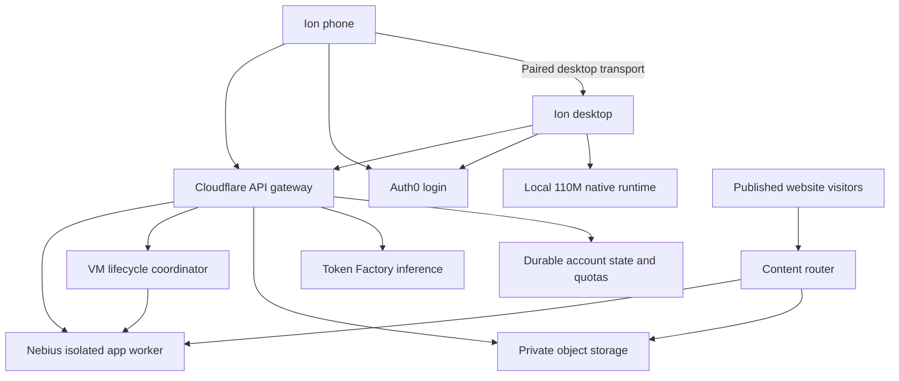

# Final Ion delivery plan: local 110M speech and managed cloud services

**Latest continuation:** [managed compute and inference implementation](117-managed-compute-and-inference.md) adds the controller, spending enforcement and shared proxy. This document retains the earlier checkpoint details.

Updated 20 October 2026. Implementation worktree: `codex/ion-cloud-auth`.

## Accepted decisions

- **Speech model:** NVIDIA `nvidia/parakeet-tdt_ctc-110m`, using the TDT decoder, with **Q8 as the first release target**. English dictation with punctuation/capitalization. Hindi, multilingual dictation and live streaming are outside this release.
- Desktop performs recognition locally. Mobile records on the phone and sends the bounded WAV to the explicitly selected paired desktop after Stop. The desktop must remain online.
- Users download model weights on first use, or explicitly from Settings/onboarding. The installer includes the matched native inference runtime, so users do not install Python, CUDA or a separate CLI.
- No shared speech service, speech VM, STT hostname or STT provider key is required.
- Auth0 login remains mandatory on desktop and mobile; browser-companion login remains outside the agreed native-login scope. The demo admits pre-created judge accounts; public signup is disabled and API admission is enforced server-side.
- Shared API gateway remains reachable while Nebius compute sleeps. Proposed deployment: Cloudflare Workers, SQLite-backed Durable Objects and private object storage.
- Nebius hosts isolated user-app builds and supported stateless application runtimes, activated only when owner policy and the budget allow it. Initial pilot: one app-worker VM, one build at a time and bounded app concurrency.
- Two independently enforced owner controls: **Nebius Cloud ON/OFF** and **Token Factory ON/OFF**. Judges cannot re-enable owner-disabled spending. Login, local coding and local speech do not start a VM.
- Existing user-selected agent environments/harnesses remain in place. Unstarted harness adapters stay out of scope.

## Honest current state

The active local adapter now selects the **110M TDT Q8 model**. Its original NVIDIA checkpoint was converted with NVIDIA's pinned converter and loaded successfully by the existing NeMo-Speech.cpp 0.1.0 Windows CPU runtime. A fixed synthetic sentence transcribed exactly; a silent recording returned no transcript. The verified artifact is 146,029,600 bytes, with its identity and attribution pinned in `resources/speech/`.

The downloader now verifies size/SHA-256, isolates partial files, supports network cancellation, serializes cross-process preparation and reports progress. Desktop/mobile setup describes English-only local dictation. The model file is staged locally; its public first-use download URL is **not published** yet.

The shared gateway now has a Workers entry point with account-scoped SQLite Durable Objects and private R2 hosting objects. Local workerd tests verify signed admission, pairing isolation, restart durability and HTML publication with compute off. The Bun gateway remains available as a separate self-hosted runtime. Closed-demo subjects and owner-only persisted Cloud/Token Factory permissions are implemented; native account settings expose them.

**Not live:** cloud provisioning, DNS/TLS, approved judge subjects, public model upload, VM lifecycle transport/controller, shared inference proxy with spending reservations and final installers/device acceptance. Nebius Compute is gRPC; Workers' `node:http2` is only a stub, so the ordinary Node gRPC SDK cannot be used there unchanged. This must be resolved with a verified supported transport before automatic wake/stop is enabled. Do not invent a REST endpoint or claim that Cloud OFF confirms a stopped VM.

See [the current implementation and operator checklist](116-110m-and-serverless-implementation.md) for evidence, commands and remaining gates. The prior [0.6B record](114-local-parakeet-dictation.md) is historical.

## Target service layout

Auth0 owns identities/passwords. Operational state still needs durable storage: device grants, task relays, release manifests, quota reservations, VM leases and usage records. No separate application-owned user/password database is required.

## Delivery sequence and checkpoints

### 1. Validate the 110M engine/model pair

- [x] Pin the upstream 110M revision, license and selected decoder.
- [x] First test an explicitly TDT-selected conversion against the existing NeMo native runtime. A hybrid CTC/TDT checkpoint must not accidentally select its auxiliary CTC head.
- [x] Verify Windows CPU loading and transcription on fixed 16 kHz mono fixtures before making it the active model.
- [x] The existing Windows CPU runtime executes the explicit TDT conversion; no replacement engine is needed for this platform. macOS and clean-machine CPU compatibility remain release checks.
- [ ] Pin source/build versions and all redistributed runtime licenses. Choose a portable CPU baseline and verify CPU instruction compatibility.
- [x] Record actual artifact bytes/SHA-256 and commit the versioned manifest identity, revision, runtime compatibility, intended download origin and attribution in source.
- [ ] Upload the exact staged model and verify the public versioned URL; source metadata does not make it downloadable.

**Gate:** actual local 110M recognition with correct punctuation, safe empty/silent output and bounded latency/memory on target Windows hardware. The published community 135 MB Q8 artifact is an example for its own engine; Ion must not promise that exact size or mix GGUF formats without validation. Model conversion is a build-time task; no Python dependency is shipped to users.

### 2. Finish local desktop and paired-phone speech

- [x] Replace the existing 0.6B model/runtime selection and hardcoded 714 MB/25-language copy together.
- [x] Implement first-use download with received-byte progress, disk-error guidance, partial-file isolation, length/SHA verification and activation only after verification. Live first-use acceptance remains below.
- [x] Bound preparation/inference; cancel network waits and kill/reap the owned direct CLI child. No downloader subprocess is created.
- [ ] Verify native cancel/retry and clean installation on actual devices. Phone cancellation currently discards the result without interrupting its daemon job.
- [x] Reuse the verified per-user model cache; cached inference does not require an STT network connection. Account/login access is a separate requirement.
- [ ] Keep model preparation/inference off the UI thread and bound CPU/thread use where the selected runtime supports it.
- [ ] Desktop: microphone → Stop → local transcript → user review/edit → explicit task send. Keep capture limits and discard on Cancel/sign-out or stale task context.
- [ ] Phone: microphone consent names the selected desktop; send a maximum 60-second/8 MiB WAV only after Stop; reject stale results after switching desktop/task or backgrounding.
- [ ] Preserve authenticated pairing and owner/control permissions when phone audio crosses the gateway. No STT provider receives the recording.
- [x] Delete temporary recordings on completion/failure and sweep only stale Ion recording names after a crash; no general temporary-folder cleanup.
- [x] Remove hosted speech from active setup/readiness; retain old credentials without using old endpoints for dictation.

**Gate:** clean Windows install with no separately installed CLI; real first-use download; cached inference; native mic/WAV and phone-to-desktop dictation. Moto G32 and iPhone 15 acceptance remain an owner/device check when available.

### 3. Deploy the shared gateway and closed demo access

- [x] Port existing HTTP relay semantics to Workers with transactional SQLite Durable Objects and R2; local workerd restart/isolation tests pass.
- [ ] Add hibernating WebSockets only if a new socket transport is required; no such implementation is claimed by the HTTP port.
- [ ] Use per-account state plus a global coordinator for compute leases and total shared limits. Preserve request deduplication and tenant isolation across restart/migration.
- [ ] Configure Auth0 issuer/audience/native clients already recorded in source; verify actual login callbacks, token renewal, revocation and mandatory login behavior.
- [ ] Disable public account creation at the identity connection and reject unapproved issuer/subject pairs in the API. Assign owner privileges separately from judge privileges.
- [ ] Keep server credentials and shared Token Factory keys in operator secrets. No native client secret, cloud admin credential or master API key is shipped in EXE/APK.
- [ ] If shared Token Factory inference is enabled, proxy only approved operations/models with per-judge and global token/cost reservations. Reconcile actual usage and fail closed when a limit is reached.
- [ ] Deploy `api.build-with-ion.tech`, verify HTTPS and outward desktop publishing, then validate task/review access from paired phones.
- [ ] Use WebSocket hibernation for eligible idle relay sockets; account for active connections and storage under the selected Cloudflare plan.

**Gate:** an approved judge signs in and links devices; unapproved accounts and cross-account requests fail; local work does not require an active Nebius VM. A sign-in requirement does not imply the whole IDE can operate without access to the login/API service.

### 4. Publish HTML and static artifacts

- [x] Add private R2 immutable artifact/release storage with hash validation, tenant ownership and explicit cleanup behavior; local integration tests pass.
- [ ] Create the live private bucket and verify deployment on the actual domain.
- [x] Implement the content router with distinct API, website and published-site browser origins.
- [ ] Verify live DNS/routes and HTTPS for each hostname.
- [ ] Pilot host pattern: **`<site-id>.build-with-ion.tech`**, with reserved control names excluded. This revises the earlier nested `*.sites.build-with-ion.tech` suggestion to fit first-level Universal SSL coverage. Route the API and website explicitly.
- [ ] Use host-only account cookies if ever needed, do not grant parent-domain cookies, prevent domain relaxation, enforce the appropriate document sandbox/CSP and do not expose API tokens to published content. A separate registrable content domain remains preferable for a public untrusted-hosting service beyond this closed pilot.
- [ ] Default owner-private publication; explicit user action enables a public link. Private objects remain inaccessible through direct bucket URLs.
- [ ] Support preview/open, new versions, rollback, unpublish and cleanup of inactive unreferenced content. Static links do not depend on an app VM remaining on.

**Gate:** nested assets and immutable revisions work; private links remain private; scripts cannot access Ion credentials; public links work only after explicit promotion; rollback/stop survive restart.

### 5. Deploy websites and backend APIs on Nebius

- [ ] Provision/configure one dedicated disposable Linux app-worker VM in the approved project/region. Bootstrap via scoped operator access; app containers receive no cloud instance credentials.
- [ ] Validate gVisor, nonroot execution, CPU/RAM/process/disk limits, read-only source, bounded writable layers and the existing quota-aware Docker/XFS requirements.
- [ ] Pin actual runtime image digests. Start with static builds and stateless Node/Bun/Python HTTP apps. Database provisioning, arbitrary Dockerfiles, persistent app disks, cron processes and multi-service stacks remain out of scope.
- [ ] Transfer reviewed source snapshots, inject encrypted secrets only into runtimes, install allowed public dependencies and gate release activation on health checks.
- [ ] Restrict egress to approved destinations; block cloud metadata, control credentials and peer application access. Keep the worker management origin authenticated and protected from direct user access.
- [ ] Run start/stop coordination outside the sleeping VM. Coalesce starts, track all active app/build leases and implement bounded readiness, idle stop, maximum runtime and failure reconciliation.
- [ ] Browser visits receive a starting page during cold start; API callers receive a retryable unavailable response. Failures must not loop indefinitely or automatically bypass a disabled owner switch.
- [ ] Owner Cloud OFF blocks new work, gates routing and initiates controlled VM stop. Verify the actual stopped state; a stop request or Linux shutdown alone is not sufficient evidence.
- [ ] Enforce the requested **USD 10 monthly ceiling** and a **USD 25 total Cloud-credit envelope** with runtime reservations and a storage/tax/safety buffer. Token Factory's separate USD 25 balance has independent limits. These are application policies, not an assurance that delayed provider bills can never exceed an estimate.

**Gate:** deploy → health check → URL → sleep → wake → stop → rollback works. Verify process/container isolation and cross-account denial on the actual Linux host. No 24/7 application availability or service-through-December guarantee is made from the current credit balance.

### 6. Package and hand over

- [ ] Build Windows installer/portable distribution with the verified 110M-capable runtime, model manifest and notices; do not bundle a development cache or stale 0.6B selection.
- [ ] Build Android APK with the final gateway origin and callbacks. Recheck first launch, sign-in, skip/resume setup, pairing, mic permission and desktop transcription.
- [ ] For an iPhone build, use a Mac/Xcode and appropriate Apple signing/provisioning; native modules require a compatible native build.
- [ ] Validate fresh installation/update, all selected origins, missing-model recovery and absence of leaked secrets from build outputs.
- [ ] Record release checks, SHA-256 values, known limits and the owner review checklist. Connect actual EXE/APK download URLs to the Ion website once artifacts exist.
- [ ] Commit the reviewed implementation worktree and integrate with `ion-prod` while preserving its separate pending changes. Merge only after a passing candidate checkpoint.

## What is already supplied

- Nebius project: `project-e04qppz9bc0026zt9y9ky7`.
- Intended region: `eu-west2`; confirm the actual project/subnet region using operator access. `default-project-eu-west2` was supplied as a name and is not sufficient subnet/instance identification.
- Budget preference: USD 10/month; separate USD 25 Cloud and USD 25 Token Factory balances reported by the owner. Actual validity/balance must be checked in the respective consoles.
- Domain: `build-with-ion.tech`.
- Assigned Cloudflare nameservers: `matias.ns.cloudflare.com`, `nicole.ns.cloudflare.com`.
- Auth0 issuer: `https://dev-amit-ksh.au.auth0.com/`; audience identifier: `https://ion-cloud-api`. The audience is not a DNS hostname.
- Desktop/mobile public client IDs and callback definitions are in the existing login configuration. Do not request these IDs again or ask for a native client secret.
- Inno Setup and Android SDK setup were previously authorized/completed. Available physical devices: iPhone 15 and Moto G32.

## Remaining owner/operator prerequisites

1. **DNS:** a fresh public query on 20 October 2026 confirms `matias.ns.cloudflare.com` and `nicole.ns.cloudflare.com`. Registrar delegation is complete. `api.build-with-ion.tech` still returns NXDOMAIN; configure the API DNS/Worker route and verify HTTPS in the active Cloudflare zone.
2. **Cloudflare deployment access:** Wrangler `whoami` on 20 October reports no authenticated session. An authenticated operator CLI/session or scoped secret-file credentials for the account/zone, Workers, Durable Objects and object storage are required. Enable the required products and confirm their billing/limits. No account password or token should be pasted into chat.
3. **Nebius operator access:** a local authenticated session or scoped service-account credential file for the supplied project. With create/manage permission we can provision the app VM; otherwise provide the created VM ID and working SSH alias. We can discover subnet/region and generate operator-only deployment secrets once access is available. Do not send private SSH keys in chat.
4. **Judge access setup:** access to review the Auth0 configuration and create/approve the demo accounts, or owner confirmation that the provided callback/connection settings and signup restrictions are applied. Share only user identifiers/roles for API admission; judge passwords belong in the private hackathon submission.
5. **Shared inference secret:** only if judges will use the owner's Token Factory quota, configure that key in operator secret storage. Local speech does not need it.
6. **Build disk space:** the 20 October check found roughly 12 GB free on C: and 40 GB on D:. Conversion succeeded and compile checks are running. Continue checking free space before large release/APK builds; do not delete source, user recordings or unrelated worktrees.
7. **Physical review later:** owner time for microphone/permission, iPhone 15/Moto G32 pairing, backgrounding and transcript review. A Mac/Xcode and Apple signing access are needed only for the iOS build/distribution path.

No model API key, paid STT account, speech VM or separate user speech installation is needed. Source work can proceed while cloud access/DNS and device review are pending. Real deployment and an end-to-end production claim require those prerequisites and successful checkpoints.

## Primary references

- [NVIDIA 110M model card](https://huggingface.co/nvidia/parakeet-tdt_ctc-110m): English, punctuation/capitalization, hybrid architecture and attribution.
- [NeMo native ASR models/conversion](https://github.com/NVIDIA/NeMo-Speech.cpp/blob/main/docs/asr/models.md), [conversion guide](https://github.com/NVIDIA/NeMo-Speech.cpp/blob/main/docs/model-conversion.md).
- [transcribe.cpp 110M port](https://github.com/handy-computer/transcribe.cpp/blob/main/docs/models/parakeet-tdt_ctc-110m.md): engine-specific Q8 artifact and validation notes; not a compatibility guarantee for NeMo-Speech.cpp.
- [Cloudflare Durable Objects pricing](https://developers.cloudflare.com/durable-objects/platform/pricing/): Free-plan eligibility, included limits and hibernation accounting.
- [Cloudflare Universal SSL coverage](https://developers.cloudflare.com/ssl/edge-certificates/universal-ssl/limitations/): full-zone root and first-level coverage.
- [Nebius VM start/stop](https://docs.nebius.com/compute/virtual-machines/stop-start): external API lifecycle control.
- [Nebius budgets](https://docs.nebius.com/signup-billing/budgets): alerts do not stop/cap usage and billing data is delayed.
