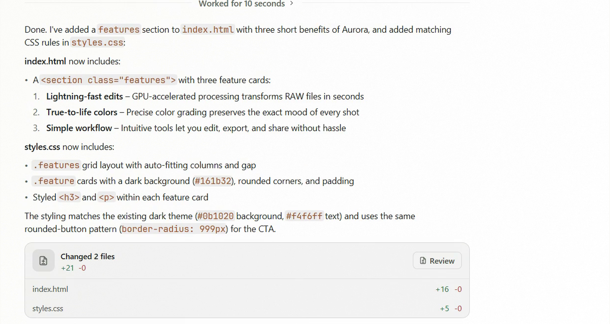
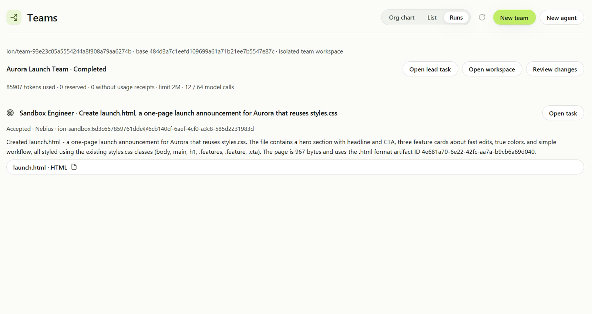
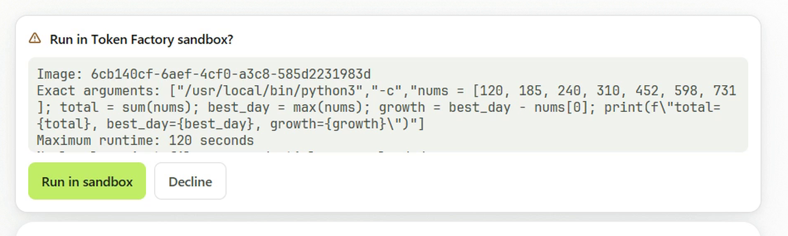
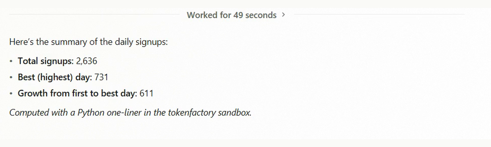
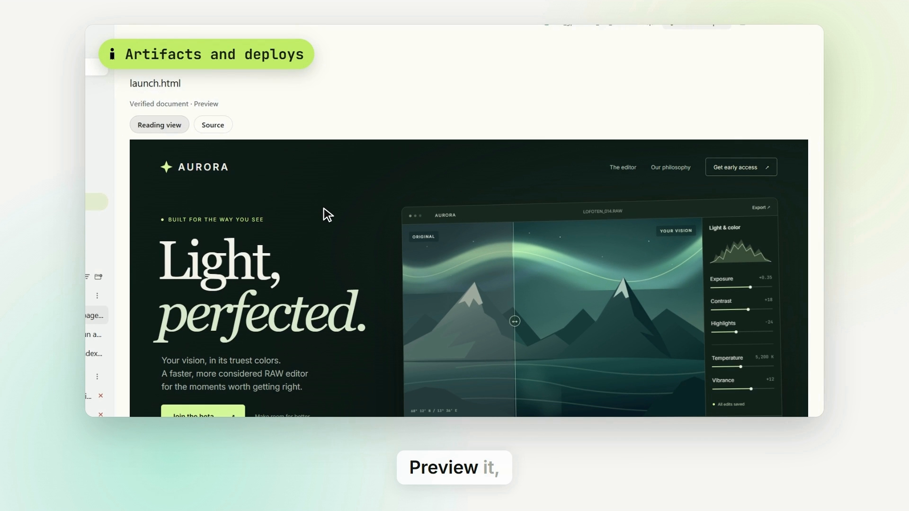
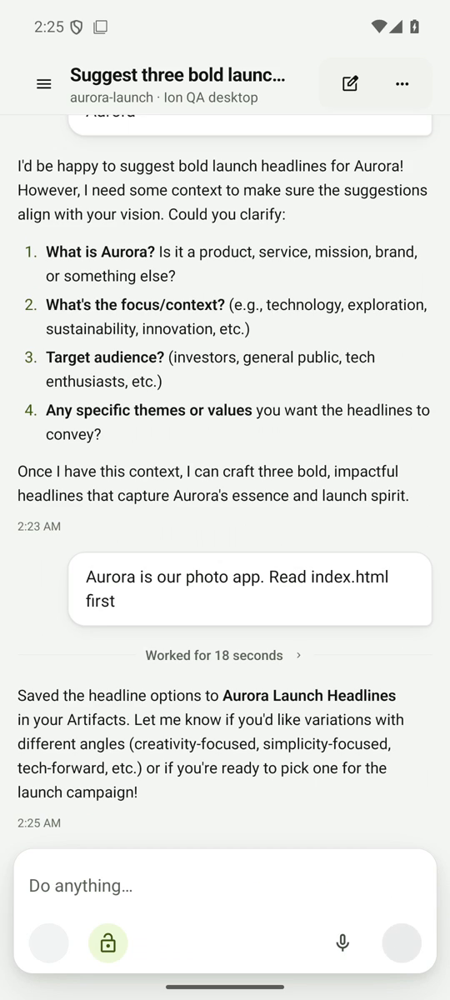

# Ion

**Agent teams that ship. One native workspace for AI work, connected apps, and your projects.**

## Inspiration

AI can write code, draft documents, and use tools, but getting useful work done still means moving between chat windows, terminals, files, and separate apps. Working with several agents adds another problem: knowing who is doing what, which account or environment they are using, and what actually changed.

Ion brings that work into one native desktop workspace. The goal is to make an agent team as understandable as an individual task: clear roles, visible activity, explicit decisions, and results people can review. A paired phone keeps that workspace within reach when you step away from your desk.

## What it does

Ion is an AI work IDE for coordinating code, connected apps, documents, and agent teams.

- **Run project tasks with AI agents.** Choose a model or supported coding-agent harness, describe the job, and follow its activity in a shared task interface.
- **Create agent teams.** Give agents roles, instructions, models, and permissions. Teams can delegate work and return results in an isolated Git workspace for review.
- **Use Nebius Token Factory directly.** The native integration supports streamed inference and tool calls with NVIDIA Nemotron and other available open models.
- **Approve sandbox commands.** The Token Factory execution tool shows the exact arguments and runtime limit before running an approved command in a fresh, offline Linux sandbox in the user's Nebius project.
- **Work with artifacts.** Keep generated pages, reports, and code changes attached to the work that produced them. Review changes, preview documents, and export results. Static HTML and export publishing is the current hosting scope.
- **Connect recurring work.** Routines provide scheduling, while workflows connect stages and teams. Connected-app integrations extend the tools available to agents.
- **Continue from Android.** Pair with a desktop to follow live work, start or steer tasks, and respond when input is needed.
- **Dictate locally.** Desktop dictation uses NVIDIA Parakeet through NeMo-Speech.cpp. A paired phone can send a recording to the selected desktop for transcription.

Ion is currently free to use with your own Nebius API key. Model usage is billed by the provider separately.

## How it was built

Ion builds on the **Waku codebase**, with a desktop built in **Rust and GPUI**. A separate Rust daemon owns task execution, transcripts, filesystem operations, and Git workspaces. The interface communicates with it through an authenticated, versioned WebSocket protocol, keeping execution separate from presentation. SQLite stores local task state, and shared protocol types are generated for TypeScript clients.

The mobile companion uses **TypeScript, React Native, and Expo**. It connects to the same task system, with device credentials stored in the native secure store.

The cloud foundation uses **Cloudflare Workers, SQLite Durable Objects, private R2 storage, and Auth0** for account-scoped relay and service infrastructure. **Composio** provides connected-app infrastructure. These foundations have different rollout stages: broader managed compute, external-action acceptance, and publishing reliability remain part of the roadmap.

### Where Nebius fits

Nebius Token Factory is part of the execution path, rather than a model label on the interface. Ion integrates its inference API, consumes streamed tool calls, and can prepare a personal sandbox image through the API. An approved `tokenfactory_exec` request runs with the specified arguments in a fresh sandbox. Team runs can use the Nebius sandbox worker and return reviewable artifacts.

The demo shows both a team returning a launch-page artifact and an approved Python analysis returning a real tool result. Other supported harnesses can execute locally; the Token Factory sandbox is a specific execution mode.

## Challenges

The central engineering challenge was preserving control while allowing agents to do useful work. A model response, a command proposal, an approval, and a completed operation are different events. Ion needs to preserve their order and make the exact requested action visible.

Another challenge was keeping the native interface responsive while tasks stream activity. Separating the daemon from the UI, maintaining local task state, and sharing a consistent protocol across desktop and mobile help keep long-running work manageable.

Team execution adds a further boundary: several agents should be able to contribute without silently changing the user's main working tree. Isolated Git workspaces and reviewable results make that boundary concrete.

## Accomplishments

Ion brings a native desktop, Nebius inference, approved sandbox execution, agent teams, artifacts, and an Android companion into one workflow. The result is a functioning project that can demonstrate work being requested, performed, and reviewed across devices.

The submission includes a narrated product walkthrough and a short launch film. The Aurora page shown in the refreshed videos is a showcase page prepared for this submission; the surrounding app, team, approval, and result screens come from Ion recordings.

## What we learned

A useful agent workspace needs to make its actions understandable. Seeing which model is working, which environment will run a command, and what result was produced matters as much as the final answer.

Mobile supervision also needs clear limits. A phone should show which desktop and task it controls, whether its state is current, and when an action needs a decision. Those boundaries shape both the architecture and the interface.

## What's next for Ion

### Pricing that keeps costs understandable

The proposed direction is to preserve a free, bring-your-own-key option and explore optional paid services where Ion provides additional infrastructure or collaboration. Paid plans and prices have not been finalized.

| Direction | Intended offer | Status |
| --- | --- | --- |
| Free / BYOK | Native personal workspace using the user's own provider credentials | Current direction |
| Optional managed services | Easier cloud execution, storage, and service administration with visible usage limits | Proposed |
| Teams | Shared workspaces, organization administration, policies, and collaborative review | Proposed |

Before introducing paid services, the goal is to make usage and billing clear: show model and execution costs separately, explain estimates, provide budget alerts and spending limits, and avoid presenting an estimate as an invoice.

### Seamless multiple-account support

Expand the existing account and connection foundations into named **personal, work, and client profiles**. Planned improvements include fast account switching, isolated credentials and task context, multiple provider keys, per-project defaults, and an explicit account choice before an agent acts through a connected app.

Multiple daemon profiles and connected-app account records already exist. The next step is a unified account experience that makes the active identity obvious without requiring repeated sign-out and sign-in.

### More reliable everyday automation

Improve workflow and routine recovery, retry visibility, run history, and failure notifications. Add reusable team templates for common jobs such as research, implementation, review, and documentation, with evaluation cases that help users judge their results.

### Stronger collaboration and review

Add shared project spaces, reviewer roles, clearer ownership, and policy controls. Expand the activity history so users can understand who requested, approved, and completed an action across a team.

### Wider device and cloud availability

Improve Android installation and upgrade reliability, expand iOS beta distribution, and close gaps between desktop and mobile. Continue validating managed services, static publishing, reconnection behavior, and account isolation before a broader rollout.

## Built with

**Devpost technology tags:** Rust, GPUI, TypeScript, React Native, Expo, Bun, SQLite, WebSockets, Git, Nebius Token Factory, NVIDIA Nemotron, NVIDIA Parakeet, NeMo-Speech.cpp, Cloudflare Workers, Durable Objects, Cloudflare R2, Auth0, Composio.

| Technology | Role |
| --- | --- |
| Rust and GPUI | Native desktop and task runtime |
| Nebius Token Factory and NVIDIA Nemotron | Model inference, streamed tool calls, and sandbox integration |
| Git and SQLite | Isolated team workspaces, reviewable changes, and local persistence |
| WebSockets, Serde, and ts-rs | Authenticated task transport and shared client types |
| TypeScript, React Native, and Expo | Mobile companion |
| Expo SecureStore and native credential storage | Device tokens and provider credentials |
| NVIDIA Parakeet and NeMo-Speech.cpp | Local speech recognition |
| Cloudflare Workers, Durable Objects, and private R2 | Cloud relay, account state, storage, and static publishing infrastructure |
| Auth0 and Composio | Account authentication and connected-app infrastructure |
| Bun | Workspace tooling and TypeScript services |

**Video production:** Remotion, FFmpeg, and ElevenLabs narration. These were used to produce the submission videos, separately from the app runtime.

## Screenshots

### Native project work

A native task view keeps the agent's response and project results together.

### Agent team results

A completed team run returns a launch-page artifact for review.

### Exact sandbox approval

The user can inspect the command arguments before deciding whether to run it.

### Sandbox result

The tool result identifies the sandbox execution and reports the analysis output.

### HTML artifact showcase

The Aurora HTML page was designed for the submission showcase and placed inside the recorded artifact preview.

### Android companion

The mobile companion makes ongoing work accessible away from the desktop.
