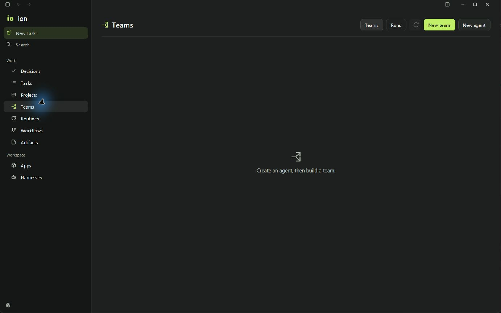

# Ion redesign: implementation and UX audit

This is the closeout of the native desktop and Android implementation, not a
release certification. The source reviewer scored all seven identified fixes
resolved. Its formal visual disposition remains **recapture** because the full
desktop/Android theme, viewport and state matrix is unavailable in this session.

## Delivered

| Area | Implemented result | Evidence and limit |
| --- | --- | --- |
| Identity | Original dotted stem/rounded loop refined as a canonical SVG; reproducible macOS, Windows, Linux, Android adaptive/themed, splash and favicon assets. | Generated from `assets/icons/ion.svg` by `scripts/assets/ion-icon.py`; packaging dimensions checked. macOS/Linux launcher presentation was not run. |
| Shared surfaces | Neutral charcoal and soft light layers, restrained lime primary actions, readable semantic foregrounds, consistent rounded control groups. | Native/mobile token source and automated AA checks. Composited/disabled/device states remain visual checks. |
| Desktop shell and Work | Grouped Work/Workspace navigation, compact object cards, contextual actions, shared workbench controls and primary action treatment. | Fresh Windows debug build and Teams capture. Existing virtualized lists remain in place. Full light/narrow/native macOS matrix is outstanding. |
| Desktop chat and settings | Bounded composer, accessible send/stop/queue activation and visible focus, clearer selected settings/navigation. | Native build and source review. End-to-end keyboard traversal and provider streaming are not certified by the isolated empty-workspace check. |
| Android navigation | Labelled Chat, Work, Artifacts and Settings destinations; compact bottom bar and an actual rail from 600dp; detail routes keep normal Back behavior. | TypeScript and source-inclusive Android export. No phone/tablet hardware or emulator rendering was available. |
| Android Work | Real Tasks, Projects, Teams and Decisions; project picker, pending solo approvals/questions, team decisions and workspace proposals. | Existing daemon data/commands and source checks. No synthetic dashboard metrics; Dashboard/Inbox remain absent from primary navigation. |
| Agent/team editing | Required instructions, explicit per-agent harness/model and Local/Nebius selection, reporting hierarchy, one lead, bounded parallelism, revision-bound drafts and explicit reload recovery. | Graph/concurrency tests and source reviewer. Device focus/IME and a live desktop-to-phone edit conflict remain unverified. |
| Apps | Existing managed catalog/connect/disconnect routes, bounded account-scoped results, safe sign-in links, pending sign-in state, retry identity and disconnect confirmation. | Actual controller boundary tests plus catalog tests. Live OAuth/account mutations were not performed. |
| Android composer and onboarding | Opaque Android surfaces, primary action styling, 48dp shared targets, recording control spacing, scrollable new-task setup, refreshed sign-in/onboarding treatment. | Source and contrast checks. 320dp/large-text/IME/recording layout still needs Android capture. |
| Existing product flows | Routines/workflows, artifacts/document previews, static-only publishing, account/usage/budget/harness behavior remain attached to their existing runtime paths. | Existing regression suite and shared component/token adoption. Those services and publication were not executed as redesign acceptance. |

## Corrections from the bounded review

The initial source pass identified seven material issues. One correction batch
fixed the managed Apps request allowlist, stale draft revision adoption,
reconnect save locks, required instructions, expanded Android navigation,
light semantic contrast and overlapping composer touch expansions. The verdict
pass scored all seven resolved in source; it did not grant whole-surface visual
approval. See [initial findings](reviewer-initial.md) and
[reviewer verdict](reviewer-verdict.md).

A subsequent actual desktop interaction found a GPUI panic when opening Teams:
the primary-button builder registered `hover` twice. It now registers one
conditional hover and one conditional active treatment. The dev watcher rebuilt
the app successfully; opening Work > Teams in that freshly launched app succeeded.
This is narrow runtime proof for that crash path.

## Verification receipts

- Native: `cargo check --locked --offline -p waku --lib --target-dir .waku-cache/native-target`
  passed. The isolated `bun ./scripts/dev.ts` watcher then built and launched the
  debug binary; the final application build completed successfully in 58.93s.
- Mobile: `tsc --noEmit -p apps/mobile/tsconfig.json` passed after the final source
  changes and worktree dependency isolation.
- General regression suite: `bun test apps/mobile/src packages/waku-client/src`
  reported **492 pass, 28 skip, 0 fail**. Skipped cases are not treated as passes.
- Focused final audit suite: palette/icon packaging, account request boundary,
  definition concurrency, Apps parsing and hierarchy validation reported
  **19 pass, 0 fail, 213 assertions**.
- Expo Android prebuild (`--platform android --no-install`) passed. No iOS project
  or device installation was made.
- A fresh readable Android export contains 2,354 modules. Its source map includes
  current worktree `_layout`, Work, Apps, both editors, navigation and the
  definition-write helper; their embedded source matches the current files.
  The final Hermes export is recorded separately in `validation.json`.

Early exports were **discarded as evidence**: a root `node_modules` junction to a
different Windows drive caused Expo Router's context to contain no application
routes despite an exit status of zero. The verification environment now has a
worktree-local dependency directory, a local copy of Expo Router, cached package
junctions, and local `@waku/client`/`@waku/mobile` workspace links. The source-map
check, rather than command success alone, establishes which source was exported.
This environment repair changes no tracked dependency versions or production
Metro behavior.

The isolated offline Gradle `:app:assembleRelease` attempt failed because its
empty cache lacks `org.gradle.toolchains.foojay-resolver-convention:1.0.0`.
An Android APK build is therefore **not verified**. The connected device belongs
to another session and no emulator is installed; neither was taken over.

## Fresh native evidence

This capture comes from the worktree's rebuilt `native-target/debug/waku.exe` at
1382 × 864. It proves the Teams crash path opens and records that dark empty
surface. It does not prove other themes, phone/tablet behavior or populated states.
Historical images under `docs/qa/2026-10-18-ion` belong to the inherited build and
were not relabelled as redesign evidence.

## Performance and accessibility boundaries

The redesign adds no desktop frame timers, blocking render I/O or provider event
pump changes. Existing `list()` virtualization and background command paths are
preserved. This is source evidence, not a new long-transcript performance
benchmark. Stream/pulse cadence and reduced-motion handling retain their existing
implementation.

New/shared native actions use keyboard activation and visible focus; Android
workbench actions expose names, selected/disabled states and at least 48dp
targets. Primary and normal/semantic text roles meet the tested contrast ratios
on the six configured layers in both themes. Complete keyboard traversal,
TalkBack, system reduce-motion, large font scale and actual hit-region behavior
still require native/device checks.

## Remaining acceptance work

1. Fresh desktop light/dark captures for populated task/composer, settings,
   routines/workflows, artifact/document and error/permission states, including
   keyboard focus and a narrow window.
2. Android phone and expanded/tablet captures in both themes, 320dp compact
   width, increased font scale, system Back, keyboard/insets and microphone
   recording/finalization/recovery states.
3. An isolated APK build with required Gradle dependencies, followed by real
   Apps sign-in/status, owner-switch/reconnect and concurrent-editor recovery
   against a disposable runtime/account.
4. Exact-provider streaming and long-transcript smoothness measurement on the
   target desktop, plus review of real artifact/export/publish states without
   bypassing the existing review-before-upload boundary.

No cloud publication, paid resource, subscription, security grant, new adapter or
release installation is part of these receipts. No merge into `ion-prod` was made.

## Requested follow-up refinements

The subsequent model-menu, editor-footer, mobile simplification and cloud-policy
changes have their own source, test and fresh-device receipts in
[refinement-audit.md](refinement-audit.md). Outstanding items above are not
automatically promoted to passes by those focused checks.
